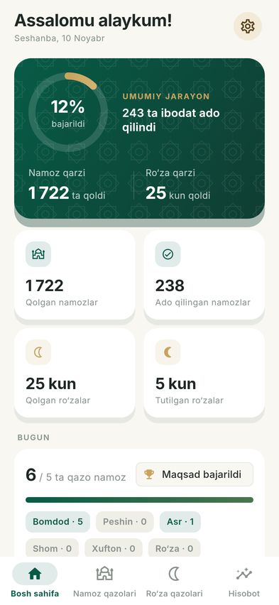
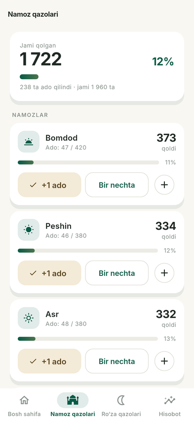
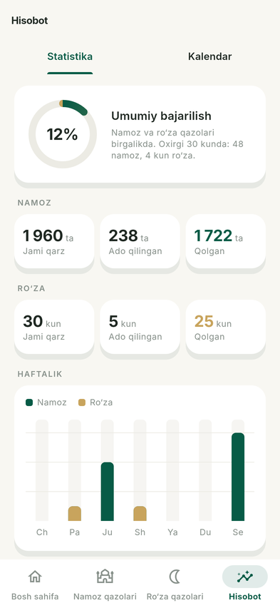
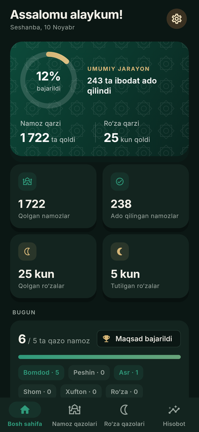

# IBODAT (QazoHisob)

Qazo namoz va qazo ro‘zalarni hisoblab borish uchun iPhone va iPad ilovasi (Flutter).
Internetsiz ishlaydi, barcha ma’lumotlar faqat qurilmada saqlanadi.

<p>
  
  
  
  
</p>

> Skrinshotlar Linux’da test muhitida Inter shrifti bilan olingan. iPhone’da
> tizim shrifti (SF Pro) ishlatiladi.

## Imkoniyatlar

- **Bosh sahifa** — umumiy jarayon halqasi, qolgan va ado qilingan namoz/ro‘za,
  bugungi xulosa va kunlik maqsad, tezkor amallar.
- **Namoz qazolari** — Bomdod, Peshin, Asr, Shom, Xufton alohida; Vitr
  sozlamalarda alohida yoqiladi. Har biri uchun boshlang‘ich qarz, qo‘shilgan
  qarz, ado qilingan, qolgan, foiz, “+1 ado”, bir nechtasini kiritish va to‘liq
  tarix.
- **Ro‘za qazolari** — har bir “Ro‘za tutdim” qarzni aynan 1 kunga kamaytiradi,
  sana tanlanadi, tarix va progress.
- **Hisobot** — statistika (haftalik va oylik grafiklar, namozlar kesimida) va
  oylik kalendar: kunlar bo‘yicha yozuvlar, shu kunga qo‘shish va tuzatish.
- **Eslatmalar** — namoz va ro‘za uchun alohida, vaqti tanlanadigan kunlik
  local notification. Eslatma hech narsani avtomatik belgilamaydi.
- **Sozlamalar** — yorug‘/qorong‘i/tizim mavzusi, Vitr, kunlik maqsad,
  JSON zaxira va CSV eksport (iOS ulashish oynasi orqali), zaxiradan tiklash,
  ma’lumotlarni tozalash (ikki marta tasdiq), maxfiylik, versiya.
- **Onboarding** — 5 ekran; boshlang‘ich qarzni kiritishni o‘tkazib yuborish
  mumkin.

### Hisob-kitob qoidalari

`Qolgan = Boshlang‘ich qarz + Qo‘shilgan qarz − Ado qilingan`

- Har bir yozuv sana va vaqt bilan saqlanadi; tarix **hech qachon jimgina
  o‘chirilmaydi** — “bekor qilish” yozuvni *bekor qilingan* deb belgilaydi va
  uni qayta tiklash mumkin. Har bir bekor qilish tasdiq so‘raydi.
- Qarzdan ko‘p ado kiritilsa, tasdiq so‘raladi. Tasdiqlansa, ortiqcha miqdor
  avval qarzga (bog‘langan yozuv sifatida) qo‘shiladi, shuning uchun qolgan
  qarz hech qachon manfiy bo‘lmaydi.
- Boshlang‘ich qarzni o‘zgartirish tarixda alohida audit yozuvi bo‘lib
  qoladi.
- Har bir amal noyob kalit bilan yoziladi — ikki marta bosish takroriy yozuv
  yaratmaydi.
- Barcha o‘zgarishlar ma’lumotlar bazasi tranzaksiyasi ichida bajariladi.

### Diniy aniqlik

Ilova — hisob yuritish vositasi, fatvo manbai emas. Miqdorlarni foydalanuvchi
o‘zi kiritadi; ilova majburiyatlarni o‘zi hisoblamaydi. Hukmlar va hisoblash
usullari farq qilishi mumkinligi, malakali olimga murojaat qilish tavsiyasi
ilovada ko‘rsatiladi.

## Arxitektura

```
lib/
  core/        theme, constants, database (Drift), notifications, router,
               utilities, widgets
  features/    home, prayer, fasting, calendar, statistics, settings,
               onboarding  (faqat UI)
  shared/      domain (hisob-kitob, statistika — sof Dart),
               data (repository’lar), widgets (umumiy oqimlar), providers
  main.dart
```

- **Riverpod** — holat; `snapshotProvider` har bir o‘zgarishdan keyin avtomatik
  yangilanadi.
- **GoRouter** — `StatefulShellRoute` bilan 4 bo‘limli pastki navigatsiya.
- **Drift (SQLite)** — `prayer_debts`, `fasting_debts`, `worship_records`,
  `settings` jadvallari, migratsiya strategiyasi (`schemaVersion`).
- **FL Chart**, **flutter_local_notifications**, **share_plus**,
  **file_picker**, **package_info_plus**.

## Ishga tushirish (macOS)

Talablar: Flutter 3.47+, Xcode, CocoaPods yoki Swift Package Manager.

```bash
cd qazohisob
flutter pub get
dart run build_runner build --delete-conflicting-outputs   # Drift kodi
flutter test
flutter run                     # simulyator yoki ulangan iPhone
flutter build ios --release     # imzolash uchun Xcode’da Team tanlang
```

- Bundle ID: `uz.qazohisob.qazohisob` (Xcode → Runner → Signing’da
  o‘zgartiring).
- Minimal iOS/iPadOS: 15.0. iPhone — portret; iPad — barcha yo‘nalishlar,
  kontent markazda 680 pt kenglikda.

## Veb-versiya (PWA) — Mac’siz iPad/iPhone’ga o‘rnatish

Ilova brauzerda ham ishlaydi va **bosh ekranga ilova sifatida** o‘rnatiladi.
Birinchi ochilishdan keyin to‘liq internetsiz ishlaydi (service worker),
ma’lumotlar brauzer xotirasidagi SQLite (WebAssembly) bazasida saqlanadi.

```bash
python3 tool/build_web.py          # natija: build/web
```

- Build nisbiy `base href` bilan chiqadi — istalgan domen yoki papkadan ishlaydi.
- `.github/workflows/qazohisob-web.yml` har push’da testlarni yurgizadi,
  veb-build’ni **qazohisob-web** artefakti (zip) sifatida saqlaydi va
  repozitoriy ochiq bo‘lsa GitHub Pages’ga joylaydi.
- Vebda eslatmalar (notification) yo‘q; ma’lumot brauzerda saqlangani uchun
  vaqti-vaqti bilan JSON zaxira olish tavsiya etiladi.
- `web/drift_worker.js` — `tool/drift_worker.dart` dan kompilyatsiya qilingan;
  `web/sqlite3.wasm` — sqlite3 3.5.2 release’idan.

**iPad’ga o‘rnatish:** Safari’da sayt manzilini oching → **Ulashish** (□↑) →
**Bosh ekranga qo‘shish** → **Qo‘shish**.

## Testlar

48 ta test: hisob-kitob, qarz qo‘shish, ado qilish, bekor qilish/tiklash,
manfiy qarzning oldini olish, takroriy yozuvlar, fayl bazada saqlanish,
zaxira/tiklash, CSV, statistika va asosiy ekranlar uchun widget testlar (iPhone va iPad o‘lchamlarida).

```bash
flutter test
flutter analyze
```
